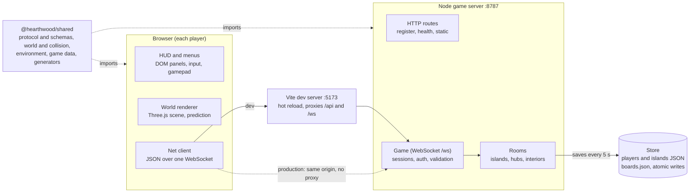
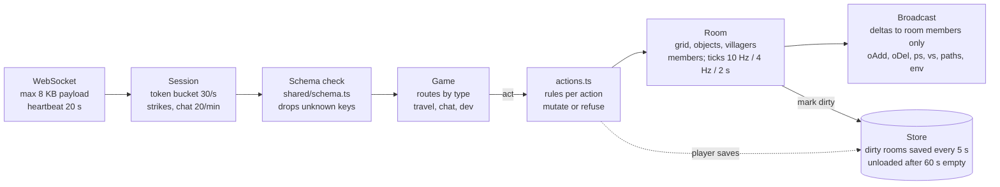
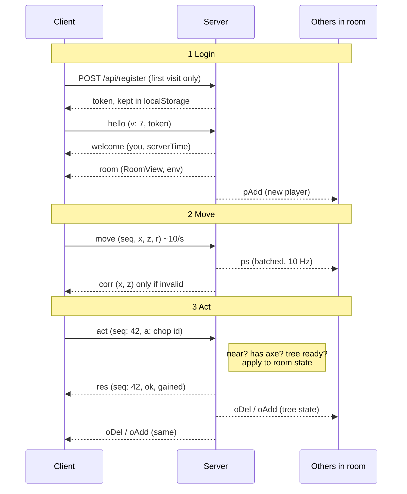
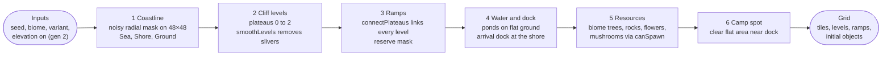
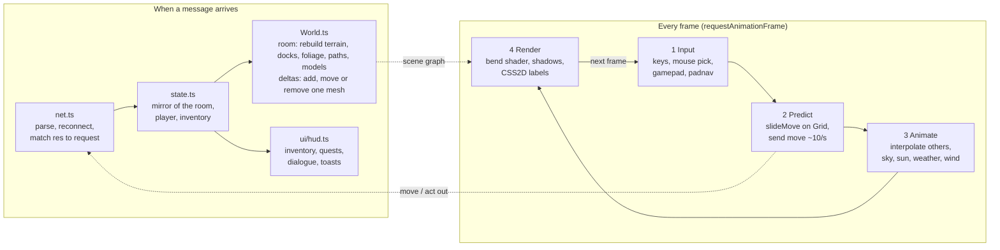

# Hearthwood – Architecture Guide

> Snapshot of the architecture guide, last updated 2026-11-12.
> This file is updated only on explicit request, not with every code change, so details may lag behind the code.

## Contents

1. [Overview](#overview)
2. [System architecture](#system-architecture)
3. [Repository layout](#repository-layout)
4. [Shared package](#shared-package)
5. [Server internals](#server-internals)
6. [Protocol and message flows](#protocol-and-message-flows)
7. [Validation and security](#validation-and-security)
8. [World model](#world-model)
9. [Environment](#environment)
10. [Gameplay systems](#gameplay-systems)
11. [Client architecture](#client-architecture)
12. [Persistence](#persistence)
13. [Testing and developer tools](#testing-and-developer-tools)
14. [Extending Hearthwood](#extending-hearthwood)

## Overview

Hearthwood is a browser-based, multiplayer island-life game. One authoritative Node.js server owns all game state; browsers only send intents and draw what the server tells them. All three parts are written in TypeScript and share one package of rules, data and protocol definitions, so client prediction and server validation run the same code.

Design goals:

- **Server-authoritative multiplayer.** Clients never decide outcomes. Every action is validated (schema, ownership, distance, tools, inventory, cooldowns, calendar gates) before state changes.
- **One source of truth for rules.** Collision, island generation, the environment model and all game data live in `shared/` and are imported by both sides.
- **Real-world time.** Day and night follow the real sun at the island owner's location; seasons follow the real calendar and the island's climate.
- **Asset-free.** Every model, texture and icon is generated procedurally (Three.js primitives, canvas textures, emoji sprites), so the repo has no binary assets.
- **Simple to run and extend.** `npm run dev` starts everything; persistence is plain JSON files behind a small interface that can be swapped for a database.

| Layer | Technology |
| --- | --- |
| Language | TypeScript 5.6 (strict), ES modules |
| Server | Node.js 20+, `ws` WebSockets, `tsx` runtime |
| Client | Vite 6, Three.js r170, plain DOM UI (no framework) |
| Shared | Pure TypeScript package `@hearthwood/shared` |
| Storage | JSON files with atomic writes |
| Tests | Bot-driven end-to-end test against a real server |

## System architecture

Every browser holds one WebSocket to the game server; the server owns the state, validates every request and pushes changes to the players who can see them.



In development, Vite serves the client on port 5173 with hot reload and proxies `/api` and `/ws` to the game server on 8787. In production, `npm run build` writes `client/dist`, and the game server serves those files itself from the same origin, so no proxy is needed.

| Endpoint | Purpose |
| --- | --- |
| `POST /api/register` | Creates a guest account, returns a random token (rate-limited per IP) |
| `GET /api/health` | Liveness, protocol version, players online |
| `GET /*` | Built client files (production only) |
| `WS /ws` | The game connection; all gameplay traffic |

## Repository layout

The repo is one npm workspace with three packages. `shared` has no runtime dependencies and is imported as TypeScript source by both sides, so a rule written once (collision, recipes, schemas) runs identically on server and client.

```
hearthwood/
├─ shared/src/
│  ├─ protocol.ts      message types, PROTOCOL_VERSION = 7
│  ├─ schema.ts        tiny runtime validator for incoming messages
│  ├─ rng.ts           seeded PRNG + hashing
│  ├─ world.ts         Grid, tiles, cliffs, ramps, island generator
│  ├─ harbor.ts        Harbor Town Square layout
│  ├─ interiors.ts     room generator for every enterable building
│  ├─ env.ts           sun, seasons, weather
│  └─ data/            items, biomes, buildings, recipes, villagers,
│                      quests, paths
├─ server/
│  ├─ src/index.ts     HTTP + WebSocket bootstrap
│  ├─ src/config.ts    env vars and limits
│  ├─ src/store.ts     JSON persistence
│  ├─ src/game/        Game, Room, Session, actions, inventory
│  └─ test/run.ts      bot-driven end-to-end test
├─ client/
│  ├─ index.html, vite.config.ts
│  └─ src/
│     ├─ main.ts       boot, login, render loop
│     ├─ net.ts        WebSocket client
│     ├─ state.ts      client-side mirror of the room
│     ├─ game/         World, terrain, models, characters, decor,
│     │                foliage, footprints, paths, bend shader
│     ├─ input/        gamepad + spatial menu navigation
│     └─ ui/           HUD, creator, world map, island previews
├─ docs/               this guide
├─ data/               runtime saves (git-ignored)
├─ setup.ps1           one-shot Windows setup
└─ .vscode/            launch + tasks for F5 debugging
```

| Command | What it does |
| --- | --- |
| `npm run dev` | Server (tsx watch) and Vite together |
| `npm run dev:fast` | Same, with `DEV_FAST=1` (time ×60, dev commands) |
| `npm run build` | Type-checks and builds `client/dist` |
| `npm start` | Production server, serves the built client |
| `npm test` | End-to-end bot test against a fresh data folder |

## Shared package

`@hearthwood/shared` is the contract between client and server. Anything both sides must agree on lives here, and it is deterministic: given the same seed and inputs it produces the same output on either side.

| Module | Responsibility | Used by |
| --- | --- | --- |
| `protocol.ts` | Every client→server and server→client message type, `RoomView`, entity shapes | both |
| `schema.ts` | Declarative validators (`str`, `int`, `obj`, `oneOf`…); unknown keys are dropped, wrong types reject the message | server |
| `rng.ts` | Seeded `mulberry32` PRNG and string hashing | both |
| `world.ts` | `Grid` (tiles, levels, ramps, reserved mask), movement and placement rules, `generateIsland`, `findFreeSpot` | both |
| `harbor.ts` | Fixed Harbor Town Square layout: terraces, stairs, boardwalk, pier, stalls, lighthouse, billboard, mailbox | both |
| `interiors.ts` | `generateInterior(spec)` builds a small walled room per building style and villager theme | both |
| `env.ts` | Sun position, local time, season and weather for a latitude, longitude and time zone | both |
| `data/*` | Static game data: items, biomes, buildings, recipes, villagers, quests, path types | both |

Because the client runs the same `Grid.canMove` and generators as the server, it can predict movement and draw the island from the seed without the server sending tile data, while the server still has the final say.

## Server internals

The server is a single Node process. Four classes do the work: `Game` owns everything, `Session` is one connected player, `Room` is one loaded place, and `actions.ts` holds the rules.



A message is size-checked, rate-limited and schema-checked before `Game` looks at it; only the action handler changes room state, and the room then fans the change out.

**Game** (`game/Game.ts`) keeps the session map (one per player id — a second login replaces the first), the loaded rooms, and travel. It answers `hello`, routes `act` to the action handlers, handles `travel` (home, shared hub, a visited island, invite code, tour, enter and exit buildings), chat, the message board and dev commands. It also migrates old island saves forward (`migrateIsland`).

**Room** (`game/Room.ts`) is one place players can stand in: an island, the shared Harbor Town Square, or an interior. Each room has its own `Grid`, objects, villagers and member list. Rooms load lazily; on load they replay elapsed time (regrowth, respawns, construction) so an island nobody visited for a week catches up in one step. Empty rooms unload after 60 s.

| Loop | Rate | Work |
| --- | --- | --- |
| Positions | 10 Hz | Batch player positions into one `ps` message per room |
| Villagers | 4 Hz | Wander, go home at night (19:00–07:00), `vs` updates |
| Slow tick | 2 s | Regrowth, resource respawn, construction, weather and season changes |
| Save | 5 s | Write dirty players and islands |

**Session** (`game/Session.ts`) wraps the socket: token bucket, strike counter, heartbeat, and a `send` helper. **actions.ts** contains one handler per action kind (`chop`, `dig`, `hit`, `forage`, `shake`, `plant`, `cast`, `reel`, `craft`, `build`, `demolish`, `place`, `pickup`, `talk`, `gift`, `buy`, `sell`, `wear`, `restyle`, `mail`, `takeMail`, `pave`, `unpave`); each checks distance, tools, inventory and grid rules, then either mutates the room and replies `ok` or replies with an error without touching state.

## Protocol and message flows

All gameplay traffic is JSON over one WebSocket; each message has a short `t` field naming its type. Types are declared once in `shared/src/protocol.ts`, and the server rejects a `hello` whose version differs from `PROTOCOL_VERSION` (currently 7), which prompts the client to reload.



The pattern is always the same: the client sends an intent, the server decides, and everyone in the room — including the sender — learns the outcome from the same broadcast. The `res` reply only tells the sender whether its own request worked (and carries private data such as inventory changes). On refusal the server replies `res` with `ok: false` and an error, and broadcasts nothing.

| Client → server | Purpose |
| --- | --- |
| `hello` | Authenticate with token and protocol version |
| `create` | Character and island creation: name, gender, look, biome, location and time zone |
| `move` | Desired position and facing, with a sequence number; validated, never trusted |
| `act` | One gameplay action `a` (keyed by `k`), with a `seq` echoed in `res` |
| `travel` | `home`, `shared`, `island`, `code`, `tour`, `enter`, `exit` |
| `chat` | Room chat (rate-limited, max 140 characters) |
| `friend` | Request, accept, decline, cancel or remove a friend by code |
| `access`, `newInvite`, `kick` | Visitor access (friends, public, invite code), new invite code, remove a visitor |
| `map` | Ask for the world map list |
| `board` | Post to or delete own note on the Harbor billboard |
| `ping` | Latency measurement (`pong`) |
| `dev` | Debug-menu commands (only with `DEV_FAST=1`) |

| Server → client | Purpose |
| --- | --- |
| `welcome` | Own profile (or none yet, which opens character creation), server time, dev flag |
| `room` | Full `RoomView` plus environment on every room change: seed, biome, levels, ramps, paths, objects, buildings, players, villagers, interior theme, board |
| `res` | Reply to one `act`: `seq`, `ok`, optional error and items `gained` |
| `corr` | Authoritative position after a rejected move |
| `ps`, `vs` | Batched player and villager positions |
| `pAdd`, `pDel`, `pLook` | Players joining, leaving or changing outfit |
| `oAdd`, `oDel`, `bAdd`, `bDel`, `vAdd` | Object, building and villager changes |
| `paths` | Paved tiles changed |
| `env` | Time, season or weather changed |
| `self`, `inv`, `quest` | Private updates to profile, inventory and quest progress |
| `bite`, `fish` | Fishing: a bite window opens, then the catch result |
| `talk`, `mail`, `friends`, `map`, `board` | Villager dialogue, mailbox contents, friend list, world map, billboard posts |
| `chat`, `toast`, `err`, `pong` | Chat lines, notices, errors, latency reply |

Travel is a full room swap: the server removes the player from the old room (others get `pDel`), loads the target room if needed, and sends a fresh `room`. The client throws its scene away and rebuilds from that view, so there is no state to reconcile between places.

## Validation and security

The server assumes every client is modified. Nothing a client sends is applied as-is: positions are checked against physics, actions against rules, and anything unexpected costs a strike.

### Accounts and sessions

- **Guest accounts.** `POST /api/register` returns a 32-byte random token (base64url). The server stores only its SHA-256 hash, so a leaked save file cannot be used to log in. Registration is limited to 20 per hour per IP.
- **Handshake.** The token travels in the first `hello` message, not the URL, so it never lands in proxy logs. A socket that has not said `hello` within 5 s is closed.
- **One session per player.** A new login replaces the old socket, which is closed with a notice.
- **Origins.** When `ALLOWED_ORIGINS` is set, WebSocket upgrades from other origins are refused.

### Traffic limits

| Guard | Limit | On breach |
| --- | --- | --- |
| Payload size | 8 KB per message | Socket closed |
| Message rate | Token bucket, 30/s, burst 60 | Message dropped, strike |
| Chat | 20 per minute, length-capped | Dropped, toast |
| Billboard | 1 post per 20 s, 60 posts kept | Refused |
| Schema | Wrong type or shape | Dropped, strike |
| Heartbeat | Ping every 20 s | Dead sockets closed |
| Strikes | More than 50 | Disconnected |

### Movement

The client predicts its own movement with `slideMove` for instant response and sends the result. The server then checks it:

1. **Speed.** Distance since the last accepted position must not exceed `4.2 × elapsed × 1.35 + 0.2` (walking speed with tolerance for jitter).
2. **Path.** The segment is sampled every 0.25 tiles; each step must pass `Grid.canMove` (no water, walls, objects, or cliff jumps — level changes only on ramps).
3. **Facing.** The angle is normalised with `wrapAngle`, so a client cannot send out-of-range values.

If any check fails, the server keeps the last good position and sends `corr`; the client snaps back. Other players only ever see accepted positions.

### Actions

Every handler in `actions.ts` re-derives what it needs from server state: it checks the player is within reach of the target, holds the right tool, has the inventory and coins, that the tile allows the operation (`canPlace`, `canPave`), that the progression gate is open (day, week, month), and — on someone else's island — that visitors are allowed to do it. Request ids from the client are only echoed back, never used to look anything up.

## World model

Every place in Hearthwood is a `Grid`: a square of tiles (48×48 for islands) with a tile type, a cliff level and an optional ramp direction per cell, plus the objects standing on it.

### Generation



`generateIsland(seed, biome, { variant, elevation })` is pure: it uses only the seeded PRNG, so the client and server build identical islands. Islands saved before cliffs existed carry `gen: 1` and stay flat; new ones are `gen: 2`. The server saves only what changed after generation; the client regenerates the base from the seed.

### Tiles and movement rules

| Tile | Walkable | Notes |
| --- | --- | --- |
| `Sea` | No | Fishing from Shore or Dock |
| `Shore` | Yes | Beach; shells, coconuts in tropical biomes |
| `Ground` | Yes | Build, plant and pave here |
| `Pond` | No | Freshwater fishing |
| `Dock` | Yes | Arrival point for visitors |
| `Ramp` | Yes | The only way between levels; keeps a reserved ring clear |
| `Floor` / `Wall` | Floor only | Interiors |

Cliffs are one unit high (`CLIFF = 1.0`). The rules every system reuses:

- `stepOk(a, b)` — same level, or a ramp facing the right way between them.
- `canMove(x, z)` — walkable tile, no blocking object, reachable from the previous sample.
- `canPlace(type, x, z)` — footprint fully on flat Ground of one level, outside reserved cells.
- `canPave(x, z)` — Ground with nothing blocking.
- `canSpawn(x, z)` — free for a resource; used by respawning.

### Objects and regrowth

Objects are trees, rocks, flowers, mushrooms, shells, buildings, furniture and decor, each with an id, type, tile, rotation and state (e.g. a tree's fruit count and chop stage). Depleted resources are removed, and the slow tick schedules a respawn; when the respawn time comes, `findFreeSpot` picks a free tile of the right kind on the island if the original one is now blocked.

### Special places

- **Harbor Town Square** (`harbor.ts`) is a fixed hand-shaped layout shared by everyone: terraced levels with stairs, a bay boardwalk and pier, market stalls, a lighthouse, a fountain, the mailbox and the public billboard.
- **Interiors** (`interiors.ts`) are small walled grids generated from a spec: the building style (tent, cabin, villager house, shop, town hall, shack, lighthouse) and, for villager houses, the villager's theme, which picks wallpaper, floor and furniture. Each interior is its own room, so entering a building is a travel.

## Environment

Time, light, season and weather on an island follow the real calendar at the island owner's location. Everything is computed by `shared/src/env.ts` from three inputs — latitude, longitude and IANA time zone — plus the current time, so client and server agree without syncing a clock beyond the server's `env` messages.

| Aspect | How it is computed |
| --- | --- |
| Local time | Server UTC time converted with the island's time zone |
| Sun and daylight | NOAA solar-position formulas give elevation and azimuth; the client turns those into sun direction, sky colour and light intensity, so a Nordic island has long summer evenings and short winter days |
| Season | Each biome has a climate model — temperate, boreal, tropical or arid — and `SEASONS_BY_MODEL` maps the month (mirrored for the southern hemisphere) to that model's seasons, e.g. wet and dry in the tropics |
| Weather | Deterministic per 3-hour block from a hash of island and block; 55% chance the previous block's weather carries over, with weights per biome and season (no snow in the desert) |
| Northern lights | Aurora Lookout shows them on clear nights in its dark season |

The server re-evaluates the environment on the slow tick and broadcasts `env` when the hour, season or weather changes. The client uses the season for foliage colour, snow cover and footprints, and the weather for rain, snow and fog effects. The debug menu can override season and weather for testing; with `DEV_FAST=1`, game time runs 60× faster.

## Gameplay systems

All gameplay rules run on the server in `actions.ts`, driven by static data in `shared/src/data/`. The client reads the same data to label buttons and grey out options, but never decides an outcome.

### Progression

Quests in `quests.ts` are grouped into four chapters, each gated by real elapsed days since the island was founded (ignored with `DEV_FAST=1`):

| Chapter | Unlocks after | Goals |
| --- | --- | --- |
| 1 Settling in | Day 1 | Craft tools, pitch the tent, build a camp |
| 2 A real home | Week 1 | Starter house, mailbox |
| 3 A village | Month 1 | Town hall, first 3 villagers |
| 4 A town | Month 2 | 7 villagers, shops |

Buildings (`buildings.ts`) are placed as construction sites, take time to finish on the slow tick, and some are enterable (`ENTERABLE`); shops and the town hall serve players only at their counter inside.

### Resources and crafting

- **Gathering.** Trees give wood and fruit and regrow; rocks give stone and ore; foraging gives flowers, shells and mushrooms per biome and season; fishing rolls from a biome and water-type table. Depleted resources respawn elsewhere if their spot is taken.
- **Crafting.** `recipes.ts` lists inputs, outputs and tool requirements; the server checks inventory and consumes items atomically.
- **Paths.** Five path types (`paths.ts`) can be paved on Ground tiles and removed again.
- **Inventory and coins.** `inventory.ts` handles stacking, limits and selling.

### Villagers

Villagers (`villagers.ts`) have a personality, likes and a home theme. They wander during the day and are indoors between 19:00 and 07:00 (`villagerAtHome`), where visitors can find them in their themed house. Talking once per day and giving liked gifts raises friendship, which unlocks new dialogue and occasional gifts back.

### Social

- **Visiting.** Each island has an access setting: friends only, public, or invite code. Public and shared islands appear on the world map.
- **Harbor Town Square.** The shared hub everyone can reach, with the mailbox and the billboard, where players post short messages (one per 20 s; the newest 60 are kept).
- **Chat** is per room.

## Client architecture

The client is a Vite-built TypeScript app with no UI framework: Three.js for the world, plain DOM for menus. It has two clocks — server messages, which change what exists, and the frame loop, which only moves and draws it.



A `room` message rebuilds the whole scene from the seed and view; smaller deltas touch one mesh. Each frame reads input, predicts the local player, animates everything else, and renders.

### Rendering pieces

| Module | Role |
| --- | --- |
| `terrain.ts` | One mesh for the island: heights per cliff level, cliff walls, ramps, shore blend; `buildDocks` for piers and boardwalks |
| `models.ts`, `decor.ts` | Low-poly procedural models for trees, rocks, buildings, furniture, props; seasonal colours |
| `characters.ts` | Player and villager figures (boy or girl, outfits, villager species) |
| `foliage.ts` | Instanced grass and plants, coloured and thinned by season |
| `footprints.ts` | Instanced snow footprints that fade over time |
| `paths.ts` | Procedural textures for the five path types, merged per room |
| `bend.ts` | The rolling-log curve: a vertex-shader patch that drops vertices by k·Δz² (k = 0.0085) relative to the camera, with optional wind sway |

### The bend

The curved horizon is not geometry. `bend.ts` patches every material's vertex shader to lower vertices by the square of their distance from the camera along the view axis, so the world appears to roll away like a log. The same patch is applied to the depth material used for shadows, otherwise shadows would land in the wrong place. Because the GPU moves vertices, anything done on the CPU — mouse picking, placing name labels — uses the matching `bendDrop()` function to apply the same offset.

### Input

Keyboard and mouse, plus the Gamepad API (`input/gamepad.ts`): left stick moves, buttons map to interact, tools and menus. `padnav.ts` lets the controller move between buttons in any open menu by screen position, so new panels work with a controller without extra code.

### UI

`ui/creator.ts` (character creation), `ui/map.ts` (world map with starting locations and shared places), `ui/islandPreview.ts` (small rendered previews in island selection) and `ui/hud.ts` (inventory, crafting, quests, dialogue, debug menu on F3) are plain DOM modules styled by `style.css`.

## Persistence

State is kept in plain JSON files under `data/` (configurable with `DATA_DIR`). There is no database: the game holds loaded rooms in memory and the files are the durable copy.

| File | Contents |
| --- | --- |
| `data/players/<id>.json` | Token hash, name, look, inventory, coins, quest progress, friendships, location, island id |
| `data/islands/<id>.json` | Seed, biome, owner location and time zone, `gen`, access setting and invite code, changed objects, buildings, paths, villagers, timers |
| `data/boards.json` | Billboard posts for shared places |

- **Atomic writes.** Each save goes to a temporary file that is then renamed over the old one, so a crash mid-write leaves the previous version intact.
- **Dirty tracking.** Rooms and sessions mark themselves dirty on change; the 5-second save loop writes only those. Rooms and players are also saved when they unload or disconnect, and on shutdown (SIGINT/SIGTERM).
- **Catch-up instead of simulation.** Unloaded islands are not ticked. Each saved timer (regrowth, respawn, construction) stores an absolute due time, so loading a room simply resolves every timer that has passed.
- **Migrations.** `migrateIsland` upgrades older saves on load — for example, adding interiors to existing buildings or replacing the old post office with a mailbox — so saves survive protocol bumps.

## Testing and developer tools

### End-to-end test

`npm test` runs `server/test/run.ts`: it starts a real server on a temporary data folder with `DEV_FAST=1`, then drives scripted bot clients over WebSocket through a full play-through — register, create a character, gather, fish, craft, pitch the tent, build, pave, enter and leave buildings, travel to Harbor Town Square, post on the billboard, visit another player's island under each access setting, talk to and gift villagers. Along the way it sends input a cheating client would: payloads that fail the schema, teleporting moves, actions on targets out of reach, and posts from too far away, and checks that each is refused. A run takes a little over two minutes.

### Dev mode

Starting with `npm run dev:fast` (`DEV_FAST=1`) speeds game time 60×, ignores progression day gates, and enables the `dev` message and chat commands:

| Command | Effect |
| --- | --- |
| `/kit` | All tools |
| `/give <item> [n]` | Add items |
| `/coins <n>` | Add coins |
| `/day <n>` | Pretend the island is n days old |
| `/finish` | Complete all construction |
| `/respawn` | Respawn all resources |
| `/weather <kind>` | Force weather |
| `/season <name>` | Force season |
| `/tp <x> <z>` | Teleport (validated tile) |
| `/clearinv` | Empty inventory |

**F3** opens the debug menu in the client: frame rate and draw calls, position and tile info, and buttons for the same commands, including season and weather pickers. All of it is refused by the server when dev mode is off.

### Editor setup

`.vscode/` contains launch configurations to debug the server with breakpoints (F5) and a compound task that runs server and client together. `setup.ps1` installs Node and dependencies on Windows.

## Extending Hearthwood

Most features touch the same three places: data in `shared`, a rule on the server, a view on the client. Bump `PROTOCOL_VERSION` whenever a message shape changes, so old clients reload instead of misreading.

| To add… | Change |
| --- | --- |
| An item | `shared/src/data/items.ts`; a model or icon in `client/src/game/models.ts` |
| A recipe | `recipes.ts` — no server change needed |
| A building | `buildings.ts` (footprint, cost, build time, `ENTERABLE`), its model in `models.ts`, and an interior style in `interiors.ts` if enterable |
| A villager | `villagers.ts` (personality, likes, theme); add a theme to `interiors.ts` for a new look |
| A biome or starting location | `biomes.ts` (climate model, tree and fish tables, palette) and its map position in `ui/map.ts` |
| A new action | Message schema in `protocol.ts`, handler in `server/src/game/actions.ts`, button or key in the client, a case in `server/test/run.ts` |
| A path type | `paths.ts` and its texture generator in `client/src/game/paths.ts` |
| A shared place | A generator like `harbor.ts`, a room id in `Game.ts`, and a map entry |

**Rules of thumb**

- Put anything both sides must agree on in `shared`, and keep it deterministic (seeded RNG only, no `Math.random`, no wall-clock reads).
- Never trust a field from the client that the server can compute itself.
- Broadcast outcomes to the room; send private data only in `res`.
- Store absolute due times, not countdowns, so unloaded rooms can catch up.
- New materials must go through `bend.ts`, or they will float off the curved world.
- Add a bot step to the end-to-end test for every new action, including one hostile variant.
